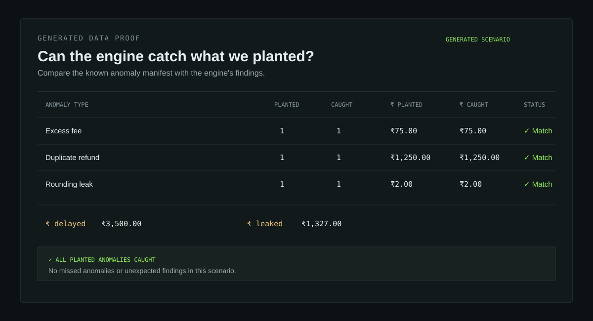

# ReconZero

[](../../actions/workflows/docker-test.yml)

ReconZero is a one-page, offline reconciliation control room. Enter a deterministic scenario seed, generate the default 100-order payment universe, and reconcile it against settlement records. The page reports the match percentage, leaked rupees by anomaly type, delayed settlement separately, and an expandable evidence trail for each finding.

## Live demo

Open the deployed app at **[reconzero.vercel.app](https://reconzero.vercel.app/)**. Use the default seed `42` (the default scenario contains 100 orders), click **Generate + Reconcile**, and review the generated-data proof panel before expanding the evidence trail.

### Proof panel

The proof panel makes the demo judgeable at a glance: it compares what the synthetic scenario planted with what the reconciliation engine caught, while keeping **₹ delayed** separate from **₹ leaked**.



## Offline setup

Requires Node 22 (the repository includes `.nvmrc`). Install exactly the checked-in dependency graph and run the checks:

```sh
nvm use
npm ci
npm test
npm run build
npm run dev
```

The UI has no runtime network calls, API keys, or external services. `.env.example` is intentionally empty of secrets. Keep one root `package.json` and one root `package-lock.json`; do not add a second application package under `src`.

## Reproducibility

The seed is passed to the public generator API and the generated result is passed unchanged to the public reconciliation engine API. Business rules and money arithmetic live in those modules; the UI only formats their result. `src/reconzero-api.ts` wires the checked-in public exports by default. An embedding can override that wiring with:

```ts
window.__RECONZERO_API__ = {
  generate(seed) { /* public generator */ },
  reconcile(universe) { /* public engine */ }
}
```

The result shape is defined in `src/reconzero-api.ts`. Amounts are integer paise; the UI converts them to rupees only for display. No floating-point arithmetic is used for calculations.

## Docker

The image installs development dependencies because Vitest is a development dependency. It can run without network access after the image is built:

```sh
docker build -t reconzero .
docker run --rm --network none reconzero npm test
```

## States

Invalid seeds, unavailable API wiring, empty reconciliations, and successful results all have explicit UI states. Findings use native expandable `<details>` rows so the evidence trail remains usable without JavaScript-specific widgets.
